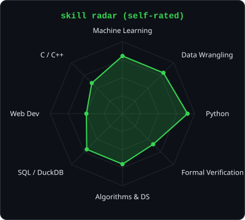
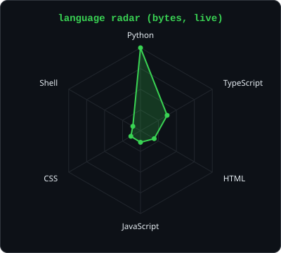
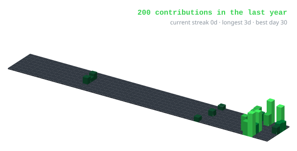
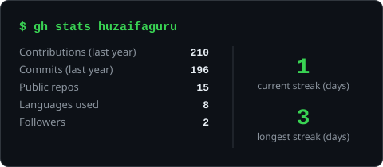
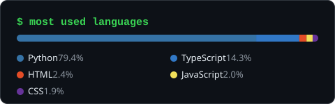
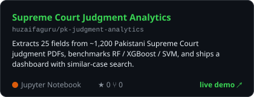
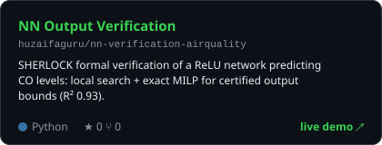
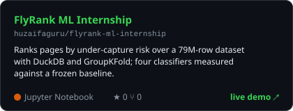
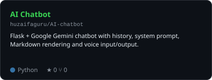

<div align="center">

<!-- PORTRAIT - generated by scripts/dotify.py from a background-removed photo.
     Halftone flips per theme, hence two files. Regenerate with:
       python scripts/dotify.py cutout.png -o assets/portrait --cols 110 -->
<picture>
  <source media="(prefers-color-scheme: dark)"  srcset="assets/portrait-dark.svg">
  <source media="(prefers-color-scheme: light)" srcset="assets/portrait-light.svg">
  
</picture>

<br>

<!-- NAME / TAGLINE - animated typing -->
<a href="https://github.com/huzaifaguru">
  
</a>

<br>

<!-- SOCIALS -->
<a href="https://linkedin.com/in/syed-mohammad-huzaifa"></a>
<a href="mailto:mohammadhuzaifa699@gmail.com"></a>
<a href="https://huzaifaguru.github.io"></a>


</div>

---

## `~/` whoami

```console
$ cat about.txt
```

Hi, I'm **Huzaifa**, a final-year BS Computer Science (AI specialization) student at **NED University**, Karachi.
I like ML work that holds up when you check it: proper baselines, leak-free splits, and results I'd still defend after a second look.

- Recently: **Machine Learning Intern @ FlyRank**, ranking pages by under-capture risk over a 79M-row dataset with DuckDB
- Built: **[Supreme Court judgment analytics](https://github.com/huzaifaguru/pk-judgment-analytics)** and **[formal verification of a neural network](https://github.com/huzaifaguru/nn-verification-airquality)**
- Looking for: **ML / AI internships and entry-level roles**
- Portfolio: **[huzaifaguru.github.io](https://huzaifaguru.github.io)**

<br>

<div align="center">

## `~/` toolbox


</div>

---

<div align="center">

## `~/` skill radar

<table>
<tr>
<td width="50%" align="center" valign="middle">

<!-- Self-rated radar - edit assets/skills.json, the workflow redraws it -->
<picture>
  <source media="(prefers-color-scheme: dark)"  srcset="assets/radar-dark.svg">
  <source media="(prefers-color-scheme: light)" srcset="assets/radar-light.svg">
  
</picture>

</td>
<td width="50%" align="center" valign="middle">

<!-- Live radar built from real language byte counts across my repos -->
<picture>
  <source media="(prefers-color-scheme: dark)"  srcset="assets/radar-langs-dark.svg">
  <source media="(prefers-color-scheme: light)" srcset="assets/radar-langs-light.svg">
  
</picture>

</td>
</tr>
</table>

</div>

---

<div align="center">

## `~/` contribution calendar

<!-- 3D isometric calendar, regenerated every 6h by .github/workflows/cards.yml -->


<br><br>

<!-- Snake eats the contribution graph - .github/workflows/snake.yml -->
<picture>
  <source media="(prefers-color-scheme: dark)"  srcset="https://raw.githubusercontent.com/huzaifaguru/huzaifaguru/output/snake-dark.svg">
  <source media="(prefers-color-scheme: light)" srcset="https://raw.githubusercontent.com/huzaifaguru/huzaifaguru/output/snake.svg">
  
</picture>

</div>

---

<div align="center">

## `~/` the numbers

<!-- Generated by scripts/build.py into this repo, so no third-party stats
     service can rate-limit or take this section down. -->
<picture>
  <source media="(prefers-color-scheme: dark)"  srcset="assets/card-stats-dark.svg">
  <source media="(prefers-color-scheme: light)" srcset="assets/card-stats-light.svg">
  
</picture>

<picture>
  <source media="(prefers-color-scheme: dark)"  srcset="assets/card-langs-dark.svg">
  <source media="(prefers-color-scheme: light)" srcset="assets/card-langs-light.svg">
  
</picture>

</div>

---

<div align="center">

## `~/` selected work

<!-- Cards generated by scripts/build.py from assets/projects.json.
     Stars, forks and language are pulled live from the API on every run. -->
<table>
<tr>
<td width="50%">
  <a href="https://github.com/huzaifaguru/pk-judgment-analytics">
    <picture>
      <source media="(prefers-color-scheme: dark)"  srcset="assets/card-pk-judgment-analytics-dark.svg">
      <source media="(prefers-color-scheme: light)" srcset="assets/card-pk-judgment-analytics-light.svg">
      
    </picture>
  </a>
</td>
<td width="50%">
  <a href="https://github.com/huzaifaguru/nn-verification-airquality">
    <picture>
      <source media="(prefers-color-scheme: dark)"  srcset="assets/card-nn-verification-airquality-dark.svg">
      <source media="(prefers-color-scheme: light)" srcset="assets/card-nn-verification-airquality-light.svg">
      
    </picture>
  </a>
</td>
</tr>
<tr>
<td width="50%">
  <a href="https://github.com/huzaifaguru/flyrank-ml-internship">
    <picture>
      <source media="(prefers-color-scheme: dark)"  srcset="assets/card-flyrank-ml-internship-dark.svg">
      <source media="(prefers-color-scheme: light)" srcset="assets/card-flyrank-ml-internship-light.svg">
      
    </picture>
  </a>
</td>
<td width="50%">
  <a href="https://github.com/huzaifaguru/AI-chatbot">
    <picture>
      <source media="(prefers-color-scheme: dark)"  srcset="assets/card-AI-chatbot-dark.svg">
      <source media="(prefers-color-scheme: light)" srcset="assets/card-AI-chatbot-light.svg">
      
    </picture>
  </a>
</td>
</tr>
</table>

<sub>

| project | live | stack |
|---|---|---|
| **[pk-judgment-analytics](https://github.com/huzaifaguru/pk-judgment-analytics)** | [demo](https://huzaifaguru.github.io/pk-judgment-analytics/) | `Python` `Pandas` `Scikit-learn` `pdfplumber` |
| **[nn-verification-airquality](https://github.com/huzaifaguru/nn-verification-airquality)** | [demo](https://huzaifaguru.github.io/nn-verification-airquality/) | `PyTorch` `PuLP/CBC` `MILP` |
| **[flyrank-ml-internship](https://github.com/huzaifaguru/flyrank-ml-internship)** | [demo](https://huzaifaguru.github.io/flyrank-ml-internship/) | `DuckDB` `Scikit-learn` `GroupKFold` |
| **[feed-ranking-simulator](https://github.com/huzaifaguru/feed-ranking-simulator)** | [demo](https://huzaifaguru.github.io/feed-ranking-simulator/) | `Python` `heapq` `Matplotlib` |
| **[AI-chatbot](https://github.com/huzaifaguru/AI-chatbot)** | n/a | `Flask` `Gemini` |

</sub>

</div>

---

<div align="center">

<sub>`01110100 01101000 01100001 01101110 01101011 01110011 00100000 01100110 01101111 01110010 00100000 01110011 01100011 01110010 01101111 01101100 01101100 01101001 01101110 01100111`</sub>

</div>
